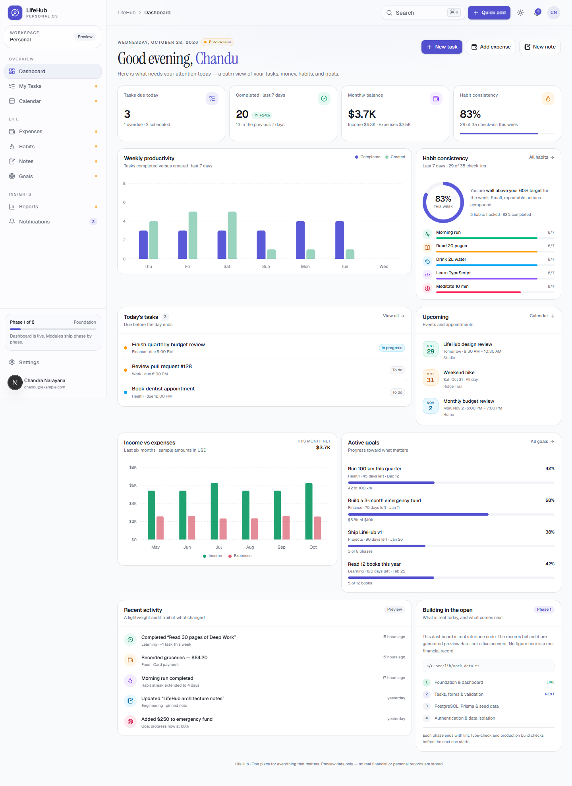
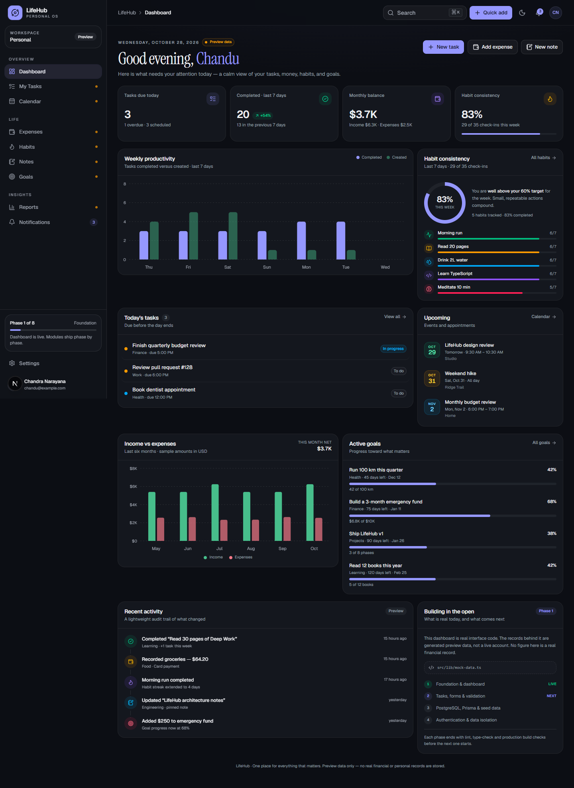

# LifeHub

**One calm place for tasks, calendar, money, habits, notes, and goals.**

LifeHub is a personal life-management app built in public, one phase at a time.
This repository currently contains **Phase 1: the foundation and dashboard**.

> **Preview data only.** Every task, balance, habit, note, and goal in the UI is
> generated sample content from `src/lib/mock-data.ts`. Nothing is stored in a
> database, no account exists, and **no figure is a real financial record**.
> The interface says so in the app; please keep that honest labelling if you
> fork it.



<details>
<summary>Dark mode</summary>



</details>

## What works today

- **Responsive app shell** — desktop sidebar at 1024px and above, a slide-out
  navigation drawer below that, and a five-item bottom bar on phones.
- **Dashboard** — greeting, preview-data badge, four computed summary cards,
  weekly productivity chart, six-month income/expense chart, habit
  consistency, today's tasks, upcoming events, active goals, recent activity,
  and the current build roadmap.
- **Derived metrics** — totals are calculated from the sample records in
  `src/lib/dashboard.ts`; they are not hard-coded into the page.
- **Global search** — `Ctrl+K` / `⌘K` or the search button opens a command
  palette over preview tasks and notes. Selecting a result navigates to the
  matching module.
- **Theme switching** — light, dark, and system themes via `next-themes`,
  selectable from the top bar, the mobile drawer, and Settings. The choice is
  stored in the browser and applied before first paint.
- **Honest module states** — Tasks and Notes have read-only previews;
  Notifications lists sample reminders. Calendar, Expenses, Habits, Goals, and
  Reports show an explicit "not built yet" roadmap page instead of fake
  buttons.
- **Supporting UI** — loading skeleton, error boundary, 404 page, skip link,
  focus-visible rings, reduced-motion support, and a branded app icon.

### Deliberately not built yet

Database persistence, authentication, creating or editing records, filtering,
reports, and automated tests. Buttons that depend on those features are either
disabled or labelled with the phase that will deliver them.

## Tech stack

| Layer      | Choice                                                    |
| ---------- | --------------------------------------------------------- |
| Framework  | Next.js 16 (App Router, Turbopack)                        |
| Language   | TypeScript, `strict` mode                                 |
| UI         | React 19, Tailwind CSS v4, shadcn/ui on Base UI           |
| Icons      | Lucide React                                              |
| Charts     | Recharts                                                  |
| Theming    | `next-themes`                                             |
| Future     | PostgreSQL, Prisma, Zod, Vitest, Playwright, deployment    |

## Getting started

Requirements: **Node.js 20.9 or newer** and npm.

```bash
git clone https://github.com/chandunarayanasetty-code/LifeHub.git
cd LifeHub
npm install
npm run dev
```

Open <http://localhost:3000>.

### Scripts

| Command             | Purpose                                      |
| ------------------- | -------------------------------------------- |
| `npm run dev`       | Start the development server                 |
| `npm run lint`      | Run ESLint                                   |
| `npm run typecheck` | Run TypeScript without emitting files        |
| `npm run build`     | Production build (also type-checks)          |
| `npm start`         | Serve the production build locally           |

Phase 1 is verified with `npm run lint`, `npm run typecheck`, and
`npm run build`.

## Project structure

```text
src/
  app/
    (app)/                  # App shell shared by every dashboard page
      layout.tsx            # Sidebar, top bar, mobile navigation
      page.tsx              # Dashboard
      loading.tsx           # Route loading skeleton
      error.tsx             # Route error boundary
      tasks/                # Read-only preview
      notes/                # Read-only preview
      notifications/        # Read-only preview
      settings/             # Working theme selector
      calendar/             # Roadmap placeholders
      expenses/
      habits/
      goals/
      reports/
    layout.tsx              # Fonts, metadata, theme provider
    globals.css             # Design tokens, dark theme, utilities
    icon.svg                # App icon
    not-found.tsx
  components/
    dashboard/              # Stat cards, charts, lists, roadmap
    layout/                 # Sidebar, drawer, top bar, search, menus
    settings/               # Theme selector
    tasks/                  # Task status and priority badges
    ui/                     # shadcn/ui primitives
  hooks/
  lib/
    mock-data.ts            # All generated preview records
    dashboard.ts            # Derived dashboard metrics
    date.ts                 # Timezone-safe date helpers
    format.ts               # Currency, number, and date formatting
    navigation.ts           # Navigation model and page titles
    search.ts               # Preview search index
    types.ts                # Shared domain types
docs/                       # README screenshots
```

## How the preview data works

- Records live in `src/lib/mock-data.ts` and are generated **relative to the
  current date**, so the dashboard never looks stale.
- Money is stored as integer cents (`amountCents`) to avoid floating-point
  rounding errors. Formatting happens only at the edge, in `src/lib/format.ts`.
- Dates use local-time helpers in `src/lib/date.ts`, including a Monday week
  start and `YYYY-MM-DD` keys for habit check-ins.
- Because "today" changes, the shell and pages opt into dynamic rendering
  (`export const dynamic = "force-dynamic"`). No preview record is cached at
  build time.
- Phase 3 replaces `mock-data.ts` with Prisma queries. Components already
  consume typed domain objects, so the UI contract should not need to change.

## Roadmap

| Phase | Scope                                                        | Status |
| ----- | ------------------------------------------------------------ | ------ |
| 1     | Foundation, responsive shell, dashboard, mock data, themes    | Done   |
| 2     | Tasks: create, edit, complete, delete, filters, validation    | Next   |
| 3     | PostgreSQL, Prisma schema, migrations, seed data               | Planned|
| 4     | Authentication, sessions, per-user ownership checks            | Planned|
| 5     | Calendar, Expenses, Habits, Notes, Goals modules               | Planned|
| 6     | Reports, in-app notifications, synced preferences              | Planned|
| 7     | Vitest unit/integration tests, Playwright E2E, a11y audit      | Planned|
| 8     | CI, production database, deployment, monitoring                | Planned|

Every phase is expected to finish with lint, type-check, and a production
build before the next one starts.

## Verification notes

Phase 1 was checked in real Chrome at 375, 390, 768, 1024, and 1440 CSS pixels:

- No horizontal overflow at any of those widths.
- Light, dark, and system themes switch and persist across reloads.
- `Ctrl+K` search opens, filters, and navigates to `/tasks`.
- Quick add and profile menus open without runtime errors and link to the
  correct placeholders.
- The mobile drawer closes after navigation; the bottom bar reaches each
  module.
- All routes render without console errors, and the app serves its branded icon
  from `src/app/icon.svg`.

There is no automated test suite yet; Vitest and Playwright arrive in Phase 7.
The checks above were run with a temporary Playwright script and headless
Chrome, not committed to the repository.

## Deployment

The app builds as a standard Next.js project and can be deployed to Vercel or
any Node.js host:

```bash
npm run build
npm start
```

No environment variables are required for Phase 1. `.env.example` documents the
variables that later phases will need.

## Author

Built by [Chandra Narayana](https://github.com/chandunarayanasetty-code).
