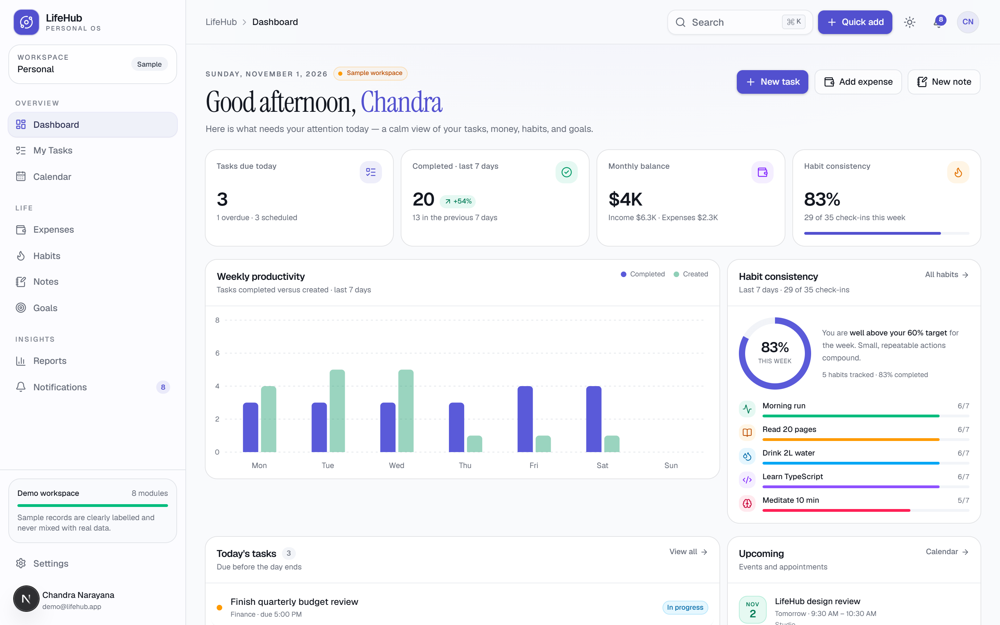
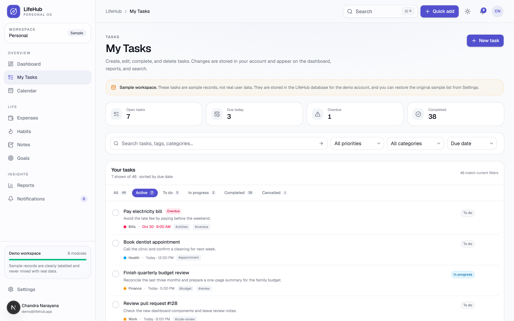
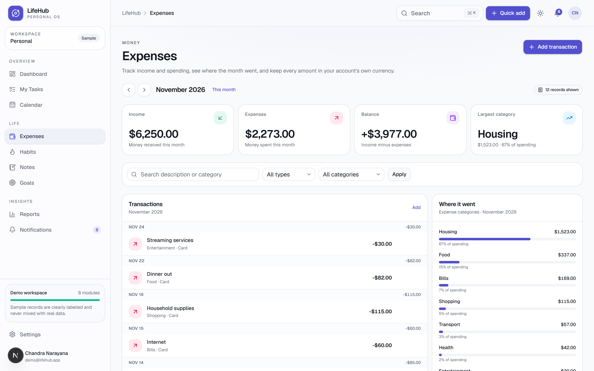
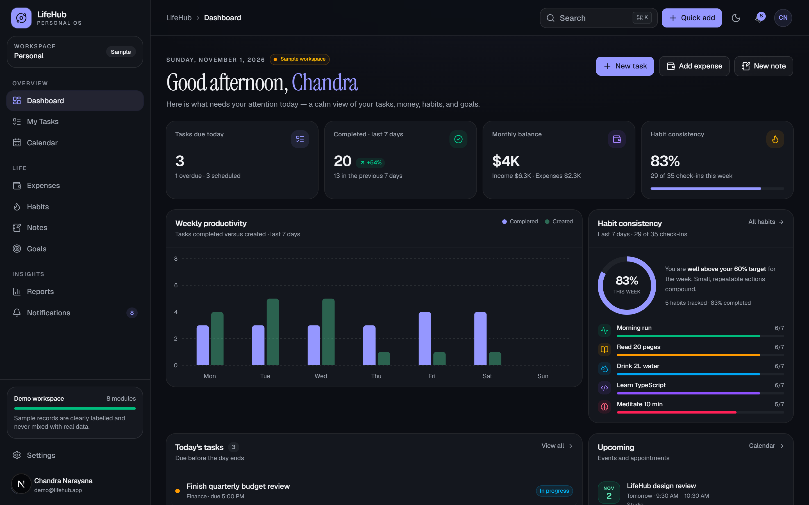
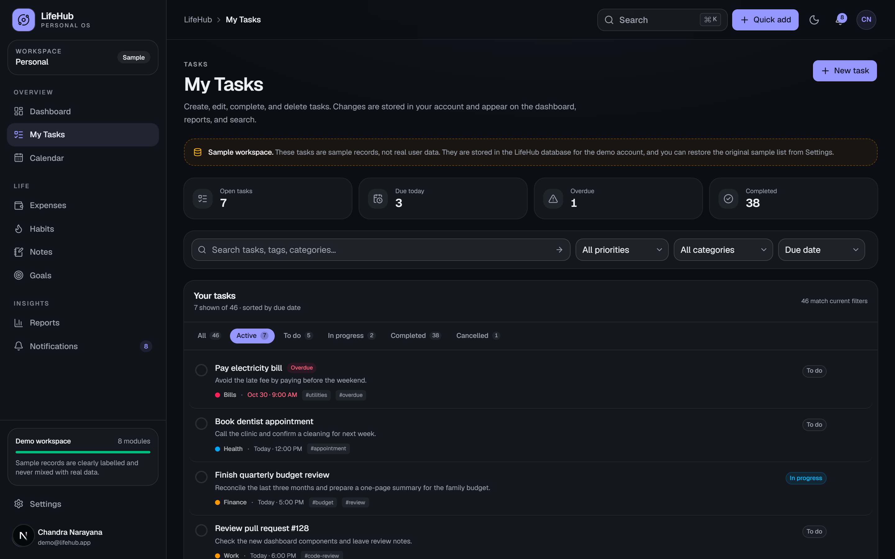
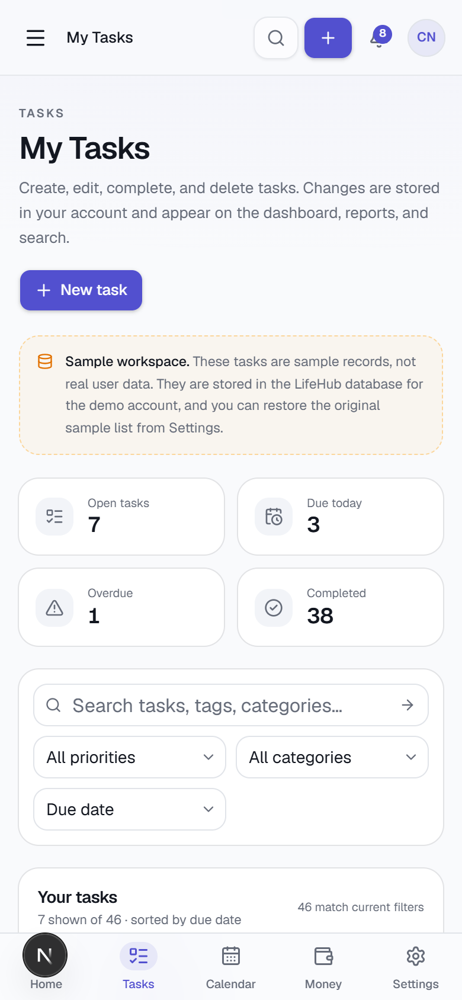

# LifeHub

**One calm place for tasks, calendar, money, habits, notes, and goals.**

[](https://github.com/chandunarayanasetty-code/LifeHub/actions/workflows/ci.yml)

LifeHub is a full-stack personal dashboard: a real Next.js app with a real
database, real accounts, and real per-user data isolation. It is deliberately
calm — one shell, eight focused modules, no growth-hacking.



<details>
<summary>More screenshots</summary>

**Tasks (light)**



**Expenses (light)**



**Dashboard (dark)**



**Tasks (dark)**



**Phone layout**



</details>

---

## Quick start

Requires **Node.js 20.9+** (24 is used in CI) and npm.

```bash
npm install     # also generates the Prisma client
npm run dev     # http://localhost:3000
```

That is the whole setup. With no `DATABASE_URL`, the app starts an **embedded
PostgreSQL database** ([PGlite](https://pglite.dev)) in `.data/pglite`, applies
the committed migrations, and seeds a demo workspace. No Docker, no database
server, no environment file.

Sign in with the demo account:

| Email | Password |
| --- | --- |
| `demo@lifehub.app` | `lifehub-demo-2026` |

Or click **Create an account** — new accounts start genuinely empty.

### Sample data, honestly labelled

The demo account contains **generated sample records**, never real figures. It is
flagged in the database (`users.isDemo`), and the interface says so: a "Sample"
badge in the sidebar, a "Sample workspace" panel on the dashboard, and wording on
each page that reads from the flag. New accounts show a "Live data" chip instead.

The demo password is public on purpose — it is a portfolio demo, not a private
account. The seed only runs for the embedded database, never for a production
build unless you explicitly set `SEED_DEMO_DATA=true`, and never when the
database already has users.

---

## What works

Every button below does something. There are no placeholder screens.

### Authentication and accounts
- Email + password registration and sign-in, with Zod validation and field-level
  errors that never reveal whether an email exists.
- Passwords are hashed with **scrypt** (Node's built-in `node:crypto`) using a
  random 16-byte salt; the plain password is never stored.
- Sessions are random 256-bit tokens in an `httpOnly`, `SameSite=Lax` cookie.
  Only the SHA-256 hash of the token is stored, so a database leak cannot be
  replayed as a live session.
- `Secure` cookies in production, 30-day expiry, sign-out deletes the row.
- Change password (revokes other sessions), and delete account (cascades all
  owned records after confirming the password).
- `src/proxy.ts` sends signed-out visitors to `/login?next=…` and returns them to
  the page they wanted. Real authorization still happens per request in
  `requireUser()`.

### Tasks
Create, edit, complete/reopen, and delete. Status tabs (all, active, to do, in
progress, completed, cancelled) with live counts, priority and category filters,
search across title/description/tags/category, four sort orders, and due-date
labelling (overdue, today, tomorrow). Filters live in the URL, so a filtered view
is bookmarkable.

### Calendar
A month grid with events you own. Create, edit, and delete events; all-day
events; locations; colour categories. Tasks due on a day appear next to the
events so the month reads as one timeline. Navigate by month, or jump to today.

### Expenses
Monthly income and spending in integer cents (no floating-point money bugs),
with a category breakdown chart, month navigation, type/category filters, and
search. Your account's currency comes from Settings.

### Habits
Daily and weekly habits with a seven-day check-in grid, one check-in per habit per
day enforced by a unique index, current and best streaks, and a rolling
completion rate.

### Notes
A searchable note library with tags and pinning. Notes are plain text — the list
and previews never render raw markup.

### Goals
Measurable targets with current value, target value, unit, deadline, category, and
status. Progress bars are computed from stored numbers, and completed goals are
kept separate.

### Reports
Honest aggregates over the last 30 days, computed from your rows: task completion
and overdue counts, habit consistency per habit, this month's income/spending
balance, category totals, upcoming events, and average goal progress. When there
is no data it shows zeros — never sample figures.

### Notifications
In-app reminders generated from **your** due tasks, upcoming events, and goal
deadlines. They are deduplicated with a stable key, so reloading does not create
duplicates. Mark one or all as read. Nothing is sent by email, and the page says
so instead of implying otherwise.

### Settings
Profile (name, currency, timezone, week start), password change, theme
(light/dark/system), demo-workspace reset, and account deletion.

### App shell
Desktop sidebar, mobile drawer, five-item phone tab bar, `Ctrl/⌘+K` search across
tasks and notes, quick-add menu, unread badge, light/dark/system themes, skip
link, and keyboard-focusable everything.

---

## Tech stack

| Layer | Choice |
| --- | --- |
| Framework | Next.js 16 (App Router, Turbopack, React Server Components) |
| UI | React 19, TypeScript (strict), Tailwind CSS v4, Base UI primitives, Lucide icons, Recharts |
| Data | PostgreSQL, Prisma 7 with driver adapters, embedded PGlite for local development |
| Validation | Zod 4 on every server action |
| Auth | Hand-rolled credentials auth: scrypt hashing, database sessions, httpOnly cookies |
| Tests | Vitest (unit + integration), Playwright (end-to-end) |
| CI | GitHub Actions: lint, typecheck, tests, build, E2E |

---

## How it works (for beginners)

A few terms, because the codebase leans on them:

- **Server Component** — a React component that runs only on the server. It can
  query the database directly, and its code is never shipped to the browser.
  Most pages here are server components.
- **Client Component** — a component marked `"use client"` that runs in the
  browser. Dialogs, menus, and theme switching need one. They receive data as
  props from server components.
- **Server Action** — an async function marked `"use server"` that the browser can
  call like a form submission. Every mutation (create task, toggle habit, mark a
  notification read) is a server action that re-validates input with Zod, checks
  the session, and writes through a repository.
- **Repository** — a module that owns database queries for one feature, e.g.
  `src/lib/tasks/repository.ts`. Every function takes a `userId` and includes it in
  the `WHERE` clause, so a forged ID cannot read or change another account's row.
- **Prisma** — the ORM that turns TypeScript calls into SQL and generates types
  from `prisma/schema.prisma`. The generated client lives in `src/generated/prisma`
  and is rebuilt by `postinstall`.
- **Migration** — a versioned SQL file in `prisma/migrations/`. Applying them in
  order is what turns an empty database into this schema.
- **PGlite** — PostgreSQL compiled to WebAssembly, running inside Node. It lets
  this project work with zero setup while using the *same* PostgreSQL schema and
  migrations as production.

### Request flow

```
Browser → src/proxy.ts (has a session cookie?)
        → app layout: requireUser() → load user + workspace
        → page (server component): repository query scoped by user id
        → client component renders the data
        → user submits a form
        → server action: validate (Zod) → requireUser() → repository write
        → revalidatePath() → the page re-renders with fresh data
```

### Project structure

```
prisma/
  schema.prisma          database schema (PostgreSQL)
  migrations/            versioned SQL applied in order
  seed.ts                optional demo seed for a real PostgreSQL database
src/
  app/(app)/             authenticated pages: dashboard, tasks, calendar, …
  app/(auth)/            login and register
  components/            UI by feature; components/ui are Base UI primitives
  lib/
    auth/                password hashing, sessions, actions, validation
    db/                  client (embedded vs Postgres), migrations, mappers, seed
    tasks/ calendar/ expenses/ habits/ notes/ goals/ notifications/ settings/
                         schema → repository → actions, per module
    reports.ts           report aggregation (pure, unit tested)
  proxy.ts               signed-out redirect with ?next=
  generated/prisma/      generated Prisma client (gitignored)
e2e/                     Playwright specs and helpers
```

---

## Database modes

| Mode | Condition | How migrations run |
| --- | --- | --- |
| Embedded | `DATABASE_URL` unset | Applied at startup by `src/lib/db/migrate.ts`, tracked in `_lifehub_migrations` |
| PostgreSQL | `DATABASE_URL` set | `npm run db:migrate` (`prisma migrate deploy`) before deploying |

Local mode is convenient but **single-process**: PGlite keeps its files on disk in
`.data/pglite`, so never run two servers against the same folder, and never use it
on a serverless host. Use real PostgreSQL for anything deployed. Full instructions,
including Vercel and Docker, are in [docs/deployment.md](docs/deployment.md).

```bash
cp .env.example .env.local   # optional; everything in it is optional
npm run db:migrate           # only with DATABASE_URL set
npm run db:seed              # optional demo account on a real database
```

---

## Scripts

| Command | What it does |
| --- | --- |
| `npm run dev` | Start the dev server on port 3000 |
| `npm run build` | Production build |
| `npm start` | Serve the production build |
| `npm run lint` | ESLint |
| `npm run typecheck` | TypeScript, no emit |
| `npm test` | Vitest: unit + database integration tests |
| `npm run test:watch` | Vitest in watch mode |
| `npm run test:e2e` | Playwright: 9 browser tests on port 3100 |
| `npm run db:generate` | Regenerate the Prisma client |
| `npm run db:migrate` | Apply migrations to `DATABASE_URL` |
| `npm run db:seed` | Create the demo account in `DATABASE_URL` |

### Tests

**Vitest** covers pure logic (task filters, expense maths, habit streaks, report
aggregation, password hashing, date helpers) and includes a real integration test
that boots PGlite in memory, applies the committed migration files, and asserts
foreign keys, unique indexes, cascades, and cross-user isolation.

**Playwright** covers the flows a person actually uses: the signed-out redirect,
sign-in and `?next=` return, wrong-password handling, demo labelling, registration
and sign-out, full task CRUD, `?intent=create` deep links, persistence across a
reload, the phone layout and drawer, and dark mode persisting.

```bash
npm run test:e2e
```

The suite starts its own dev server on port 3100 with a separate database folder
(`.data/pglite-e2e`) and the demo account seeded. Locally it uses the installed
Chrome channel if present; CI installs Chromium. If your machine has no Chrome,
run `npx playwright install chromium` first.

---

## Security notes

- Every repository query is scoped by `userId`; ownership is enforced in the
  query, not just in the UI. The integration test proves a cross-user update
  affects zero rows.
- Server actions validate with Zod before touching the database, and re-check the
  session, because a form post can arrive without the UI.
- SQL injection is not a concern: Prisma parameterises queries.
- Session tokens are hashed at rest, cookies are `httpOnly`, and production
  cookies are `Secure`.
- Password hashing is scrypt with a per-password salt. Comparison is
  constant-time (`timingSafeEqual`).
- Post-login redirects only accept in-app paths, so `?next=//evil.example` is
  rejected.
- Deleting an account cascades to tasks, events, transactions, habits, notes,
  goals, notifications, and sessions.

---

## Honest limitations

- **No email delivery.** Notifications are in-app only, and the UI says so. There
  is no password reset email either; a forgotten password needs a database reset.
- **No OAuth, 2FA, or avatars.** Credentials auth only; avatar initials are
  computed from the name.
- **No file uploads.** Notes are plain text.
- **No recurring transactions or habit reminders** yet.
- **Embedded mode is single-instance.** It is a development convenience, not a
  deployment target.
- **Reports use a fixed 30-day window.** It is labelled in the UI rather than
  pretending to be configurable.
- **Demo data ages.** Sample records are generated once, when the demo account is
  first seeded, so their dates stay fixed. If a demo has been running for months,
  its current month will look sparse until you delete `.data/pglite` (embedded
  mode) and restart to reseed.

## License

Personal portfolio project. Use the ideas freely.
